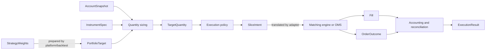

# Execution package architecture

Purpose: describe the engine-neutral execution contracts, module ownership, data flow, invariants,
and dependency boundaries implemented by `packages/execution`.

Usage: read this document before changing instrument metadata, portfolio targets, sizing, execution
policies, event DTOs, accounting identities, or reconciliation. The StrategyWeights →
Nautilus backtest bridge lives in `packages/platform/backtest`.

Status: public deterministic execution core.

# --------------------------------------------------------------------------- #
# Role in the system
# --------------------------------------------------------------------------- #

`packages/execution` is the pure, engine-neutral layer between portfolio decisions and an execution
adapter. It answers four questions:

1. What portfolio target is requested for each instrument?
2. What signed quantity change does that target require from the latest realized account state?
3. How is that quantity divided into deterministic, bounded order intents?
4. Do the resulting fills, outcomes, cashflows, positions, and shortfall reconcile exactly?

The package does not load market data, interpret strategy signals, or simulate an exchange. Order
submission happens only through the live transition engine (`transition.run_transition`) and a
venue plug-in implementing its `Venue` port; wire formats, credentials and venue gates stay in the plug-in.



`StrategyWeights`, preparation, adapter translation, Nautilus lifecycle, mutable projection, and
report generation are shown for context but are not owned by this package.

# --------------------------------------------------------------------------- #
# Module ownership
# --------------------------------------------------------------------------- #

| Module | Owns | Does not own |
|---|---|---|
| `instruments.py` | `InstrumentKey`, supported `InstrumentSpec` metadata, product/currency identity | venue discovery or instrument downloads |
| `targets.py` | target weights, reference prices, portfolio targets, initial/account/position snapshots, target quantities | strategy logic or mutable positions |
| `sizing.py` | deterministic target sizing, increment rounding, concrete quantity/notional limit validation | order submission or price discovery |
| `policies.py` | immediate, delayed market, and deterministic time-weighted taker intent planning; `ParentOrderPolicy` with its per-minute maker decisions (`maker_child_lots`, `maker_price`) shared by backtest and live | adaptive routing, liquidity models, fill simulation, or live scheduling |
| `events.py` | immutable intents, fills, outcomes, funding, holdings, shortfall, and complete execution results | exchange-native event objects |
| `resting.py` | explicit resting-limit orders, two-member OCO plans, terminal outcomes, and aggregate results | market-data matching or exchange simulation |
| `accounting.py` | pure fee, funding, equity, shortfall, and fill-uniqueness identities | persistent ledgers or mutable account projection |
| `_checks.py` | shared primitive validation for finite decimals, UTC timestamps, strings, and unique IDs | domain workflows |
| `__init__.py` | curated public imports and package version | implementation logic |
| `payload.py` | fail-closed readers that turn untyped provider payloads into named, validated values | venue-specific shapes or product facts |
| `pricing.py` | the top-of-book `BBO` and the capped marketable limit price, rounded inward to a tick | venue price grammars beyond a fixed tick |
| `journal.py`, `locking.py`, `ownership.py` | provider-neutral durability, single-run locking, and owned-order identity | provider payloads or credential access |
| `transition.py` | the one live flat-then-target sequence (`run_transition`), the `Venue` port, at-most-once submit, `Unresolved`/`Rejected` | gates, caps, wire formats, journals, or any named venue |

The public API is imported through `execution`. Provider adapters are separate consumers and are
neither mounted nor re-exported by the root package.

The optional resting-limit contracts are inputs and outputs for the project-owned deterministic
OHLC matcher in `packages/platform/backtest`. They do not change the market-IOC policy contracts.
Live maker execution (`execution.maker.work_maker_leg`, called from a venue's `submit`) works one
`run_transition` leg with one post-only order at a time, re-pegged every `repeg_interval`, and proves each child
terminal and the position equal to own fills before the next. A venue with `net_resize`
trades a same-side resize as one difference order, reduce-only when shrinking.

# --------------------------------------------------------------------------- #
# Core data flow
# --------------------------------------------------------------------------- #

## 1. Instrument identity

`InstrumentKey` is the stable venue-and-symbol identity used by every target, price, position,
intent, fill, funding settlement, and reconciliation record. `InstrumentSpec` supplies the product
facts required for sizing and validation:

- product and settlement identity;
- base, quote, and settlement currencies;
- contract multiplier;
- price and quantity increments;
- minimum and maximum order quantity;
- minimum and maximum order notional; and
- maker and taker fee rates.

The core contract validates provider-independent numeric and linear-engine invariants. Each
installed venue owns its product, currency, symbol, and multiplier validation under
`extensions/venues/`; support must not be inferred from structurally similar metadata.

## 2. Atomic portfolio target

`PortfolioTarget` represents one decision-time portfolio request. It contains instrument weights,
a CASH residual, decision and earliest-execution timestamps, and completed-close reference prices.
The target is atomic: sizing evaluates all of its legs from one immutable `AccountSnapshot`.

The foundational StrategyWeights provenance and prepared-payload integrity hashes are owned and
verified by `packages/platform/backtest` before this target reaches an execution adapter.

An optional `InitialAccountState` represents carried nonzero positions at the first decision. It
contains positive settlement cash, increment-aligned signed positions, their average prices, and
exact decision-time marks. `None` remains the canonical flat start. The backtest adapter binds this
state into prepared provenance and reconciles it into the projection and matching engine without
manufacturing an order or economic event.

## 3. Sequential quantity sizing

`size_target_quantities` converts each target weight into a desired signed contract quantity:

```text
desired_notional = realized_equity * target_weight
raw_quantity     = desired_notional / (reference_price * contract_multiplier)
desired_quantity = round_toward_zero(raw_quantity, quantity_increment)
delta_quantity   = desired_quantity - current_quantity
```

Sizing always uses the latest realized account snapshot supplied by the caller. It does not assume
the prior target filled as requested. Every nonzero delta is validated against the declared order
quantity and notional bounds. Current positions must already align to the instrument increment.

## 4. Intent planning

An execution policy maps `TargetQuantity` records to immutable `SliceIntent` records:

- `ImmediateMarketPolicy` emits one due market IOC intent for each nonzero delta.
- `DelayedMarketPolicy` emits one market IOC intent for each nonzero delta after an explicit delay
  measured from the decision timestamp.
- `TimeWeightedTakerPolicy` divides a signed delta into deterministic increment-aligned parts over
  a declared interval. Quotient/remainder allocation conserves the exact signed total, and zero
  parts are omitted.

Each policy exposes `schedule_times(decision_at, earliest_execution_at)` so preparation can
preflight its exact completed-close requirements before Nautilus construction. Policy scheduling
never permits execution before `earliest_execution_at`.

Policies describe intent only. They do not claim an order was accepted or filled. The adapter must
validate every concrete child against the instrument limits at its submission price before
constructing an engine-native order.

## 5. Terminal events

The adapter translates engine events into package DTOs:

- `Fill` records signed quantity, price, fee, currency, timestamp, and provenance.
- `OrderOutcome` gives each intent exactly one terminal status, its fills, terminal timestamp,
  unfilled quantity, and optional reason.
- `FundingSettlement` records one explicit rate and mark for one instrument and time.

IDs and provenance are part of the economic contract. Duplicate fills or funding identities,
unknown target/slice relationships, inconsistent quantities, or nonterminal outcomes fail closed.

## 6. Accounting and reconciliation

Accounting helpers are pure functions over immutable records. The authoritative identities include:

```text
funding_cashflow = -signed_position * mark * multiplier * rate
equity = settlement_cash + unrealized_pnl
```

Positive funding rates mean longs pay and shorts receive. Fees use a signed cost convention:
`cash_after_fee = cash_before_fee - fee`. Positive fees debit cash and negative rebates credit it.
Implementation shortfall uses one frozen signed convention in which positive values are worse and
reconciles delay, trading, fees, and the terminal effect of unfilled quantity.

`ExecutionResult` is the complete immutable ledger. It requires complete target quantities, exactly
one outcome per intent, exact top-level/outcome fill agreement, unique economic identities, and
consistent target/instrument provenance.

# --------------------------------------------------------------------------- #
# Architectural invariants
# --------------------------------------------------------------------------- #

- All money-path values are finite `Decimal` values; float arithmetic is not authoritative.
- Every timestamp entering an execution DTO is explicit UTC.
- Instrument identity is consistent across targets, quantities, intents, fills, funding, and
  positions.
- Sizing uses `equity × weight / (price × multiplier)` and applies the multiplier exactly once.
- Initial state contains only nonzero positions with exact mark coverage at its UTC `as_of`.
- Quantity rounding is deterministic and toward zero.
- Whole target deltas and actual child orders must satisfy declared quantity/notional limits.
- No policy emits a zero-quantity intent.
- Slice quantities conserve the exact signed parent delta.
- Every intent has exactly one terminal outcome; every fill belongs to exactly one outcome.
- Fees and funding are applied exactly once, with unique event identities.
- Projected and realized signed positions must reconcile exactly; divergence is fatal.
- The package contains no imports from strategies, backtest, Nautilus, or provider loaders.

# --------------------------------------------------------------------------- #
# Dependency direction
# --------------------------------------------------------------------------- #

Allowed dependency direction:

```text
standard library
      ↓
packages/execution
      ↓
packages/platform/backtest
      ↓
strategy runners and research workflows
```

`packages/execution` may not depend upward. In particular:

- it cannot import `strategies` or interpret strategy-specific fields;
- it cannot import `backtest` or return `BacktestResult`;
- it cannot import Nautilus or expose Nautilus-native objects; and
- it cannot load provider data, credentials, or any private venue extension.

Reusable execution mechanics belong in core only when they are provider-neutral and part of the
owned contract. Concrete OMS, gate, account, caps, and kill-switch behavior stays outside the core; the core owns
only the venue-neutral transition sequence and its failure model.

# --------------------------------------------------------------------------- #
# Live transition engine
# --------------------------------------------------------------------------- #

Every live venue runs the same sequence, owned once in `transition.run_transition`:

1. `authorize` — gates, arming, credential binding, target shape; before any read.
2. `session` — account lock and any durable run state for the whole transition.
3. `load` + `plan` — one venue truth, sized into a signed `TransitionPlan`.
4. Dry run: `preview` + `settle(dry_run=True)`; no legs, preview facts in `detail`.
5. Live: close any position (`OrderLeg("close")`, reduce-only), require an exact fill,
   reload and re-plan from fresh truth, require exactly flat, open the target
   (`OrderLeg("open")`), `confirm`, then `settle`.

A venue is a plug-in implementing the `Venue` protocol under `extensions/venues/`; the core
never imports one. Venues use `submit_at_most_once` so a create is attempted at most once per
client order id. After the first mutation, anything the engine cannot prove raises `Unresolved`:
reconcile the original client order id, never retry or re-mint. `Rejected` means the venue
definitively created nothing. Per-venue differences (gates, submit-boundary re-checks, journals)
are deliberate and belong in each venue's own documentation.

# --------------------------------------------------------------------------- #
# Failure model
# --------------------------------------------------------------------------- #

The layer fails closed with `TypeError` for wrong runtime object types and `ValueError` for invalid
domain facts or broken identities. Callers and adapters may translate those failures into their own
public boundary errors, but must not continue with a partial target, intent set, or ledger.

Validation occurs as close as possible to the owning boundary:

- DTOs reject malformed immutable state during construction;
- sizing rejects missing specifications, misaligned positions, and invalid whole deltas;
- policies reject invalid schedules and non-conserving inputs;
- accounting rejects duplicates and inconsistent fill/outcome declarations; and
- adapters remain responsible for validating the actual child order immediately before submission.

# --------------------------------------------------------------------------- #
# Testing and change discipline
# --------------------------------------------------------------------------- #

Changes must preserve the package import boundary and be proven at the smallest owned layer:

```bash
uv run --project packages/execution pytest packages/execution/tests -q
uv run ruff format --check packages/execution
uv run ruff check packages/execution
uv run ty check --project packages/execution packages/execution
build_dir="$(mktemp -d)" && trap 'rm -rf "$build_dir"' EXIT
uv build --project packages/execution --out-dir "$build_dir"
```

Money-path changes also require independent synthetic-oracle coverage through the backtest audit.
New products, policies, or event semantics require planted literal outcomes and failure cases; they
must not be introduced merely because an existing type can be generalized.

# --------------------------------------------------------------------------- #
# Explicit non-goals
# --------------------------------------------------------------------------- #

The public `execution` core is not:

- a strategy framework or source of trade decisions;
- an exchange connector, broker, OMS, or persistent order store (venues plug in from `extensions/`);
- a market-impact, queue, spread, latency, or liquidity simulator;
- a multi-venue OMS or capital allocator; or
- evidence that any strategy is profitable or safe for real capital.
